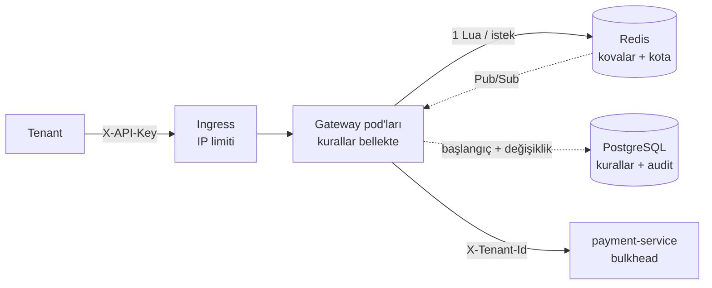

# #001 — Çok Kiracılı (Multi-Tenant) Dağıtık Rate Limiter

| Tarih | Kategori | Zorluk | Durum |
|---|---|---|---|
| 2026-10-15 | Klasik | ⭐⭐⭐ Orta | Adım 1–4 tamam ve kodlandı · Adım 5–6 (hot key, multi-region, Redis kesintisi) **devam ediyor** |

## 1. Senaryo

**PayLink**, Stripe Payment Links'e benzer bir B2B SaaS ürünü. Tenant'lar (e-ticaret siteleri, fatura yazılımları…) public REST API'yi kullanarak ödeme linki oluşturuyor (`POST /payments`), durum sorguluyor (`GET /payments/{id}`) ve webhook alıyor. Son kullanıcı linke tıklayıp PayLink'in barındırdığı sayfada ödeme yapıyor.

Geçen ay bir tenant'ın bozuk retry döngüsü API'ye **40K RPS** bastı, DB connection pool'u tükendi ve **tüm müşteriler** 20 dakika boyunca 5xx aldı. Bu olayın tekrarlanmaması için bir rate limiting katmanı isteniyor.

## 2. Gereksinimler

**Fonksiyonel**
- Limitler tenant, API key ve endpoint bazında tanımlanabilmeli. Free: 10 req/s ve 50K/gün · Pro: 200 req/s, burst 400 · Enterprise: tenant'a özel. Yazma endpoint'leri daha sıkı limitli.
- Limit aşılınca `429` ile birlikte `Retry-After` ve `X-RateLimit-Limit/Remaining/Reset` header'ları dönmeli.
- Limitler deploy olmadan değiştirilebilmeli ve değişiklik **≤10 sn** içinde tüm pod'lara yayılmalı.
- Global koruma olmalı: backend toplamda **25K RPS**'i aşmamalı.

**Fonksiyonel olmayan**
- Ortalama 15K RPS, tepe 60K RPS · 8.000 tenant · 30.000 API key
- Rate limit kontrolü için **p99 < 5 ms**, erişilebilirlik %99.95
- Tenant limitini %5–10 aşmak kabul edilebilir, haksız 429 kabul edilemez
- 2 bölge active-active (eu-central, eu-west), bölgeler arası RTT ~25 ms

**Bilerek konmuş zorluklar:** hot key (bir tenant trafiğin %35'ini oluşturuyor), Redis kesintisi, bölgeler arası gecikme, clock skew, retry fırtınası.

## 3. Yakup'un yorumları (adım adım tartışmanın özeti)

| Adım | Yakup'un yorumu | Tartışmada netleşen |
|---|---|---|
| 1. Algoritma | Saniyelik ve günlük için iki ayrı limit olmalı. Fixed window'un sınır problemi ciddi. Günlük limit bir counter gibi çalışır. | Saniyelik limit **token bucket** ile, günlük kota **fixed window counter** (UTC günü) ile uygulanır. Kota iş kuralı olduğu için sınır problemi önemsiz. |
| 1b. Kota sayımı | 429 sayılmamalı, limiter'dan geçen her istek sayılmalı. | 2xx ve 4xx sayılır, **5xx dönerse kota iade edilir** (refund). |
| 1c. Burst | Free plan için burst = 10 olmalı, ücretsiz kullanıcı kaynak harcamasın. | Geçerli bir iş kararı. Karşı argüman: Free kullanıcılar gelecekteki Pro müşteriler, iyi bir deneyim dönüşüme yardım eder. |
| 2. Yer | API Gateway, çünkü ilk karşılayan nokta orası. | Gateway tenant'ı tanıyan ilk nokta. Öncesinde LB/WAF'ta IP limiti, servis içinde de **bulkhead** olarak son sigorta var (defense in depth). |
| 3. State | Lokal sayaçta pod sayısı × 200 geçer. Ortak bir Redis olmalı. | Kovalar Redis'te tutulur. Race condition (lost update) **Lua script** ile atomik hale getirilir. Zaman Redis'in `TIME` komutundan alınır, böylece clock skew etkisiz kalır. |
| 4. Kurallar | Redis'te tutalım, daha hızlı. | Kuralların kaynağı **PostgreSQL** (kalıcılık ve audit), okuma ise **pod belleğinden** yapılır (Redis'ten bile hızlı). Değişiklikler Pub/Sub ile yayılır. |
| 4b. Öncelik | (c) İstek birden fazla kovadan geçmeli. | (c) ve (d) birlikte: Her katman ayrı değerlendirilir, her katmanda **TENANT > PLAN** önceliği uygulanır. Tüm kovalar tek Lua çağrısında, **hepsi ya da hiçbiri** mantığıyla kontrol edilir. |

## 4. Önerilen tasarım (Adım 1–4)



Detaylı diyagramlar: [`design/architecture.mmd`](design/architecture.mmd), [`design/request-flow.mmd`](design/request-flow.mmd), [`design/policy-propagation.mmd`](design/policy-propagation.mmd)

### Bir istek nasıl işlenir?
1. **Kimlik (bellek):** `sha256(X-API-Key)` ile rehbere bakılır ve tenant ile plan bulunur. Key bulunamazsa 401 döner.
2. **Kurallar (bellek):** Genel kova (`*`), varsa endpoint kovası ve günlük kota çözülür. Her katmanda TENANT kuralı PLAN kuralından önce gelir.
3. **Tenant kovaları (Redis, 1 çağrı):** `token_bucket.lua` tüm kovaları ve kotayı birlikte kontrol eder. Hepsinde jeton varsa hepsinden düşer, birinde bile yoksa hiçbirinden düşmez.
4. **Global kova (Redis):** Kapasite doluysa kota iade edilir ve 503 döner (bu müşterinin suçu değil).
5. **İlet:** `X-API-Key` silinir ve `X-Tenant-Id` eklenir (client bu header'ı gönderse bile ezilir). Downstream 5xx dönerse kota iade edilir.

### Veri modeli

```sql
rate_limit_policy (id, scope_type PLAN|TENANT, scope_id, endpoint '*'|'POST /payments',
                   rate_per_sec, burst, daily_quota NULL=devral, version, updated_by, updated_at)
                   UNIQUE (scope_type, scope_id, endpoint)
rate_limit_policy_audit (... changed_by, changed_at)    -- kim, ne zaman, neyi değiştirdi
api_key (key_hash PK, tenant_id, plan, active, version) -- düz metin key asla saklanmaz
```

**Redis key'leri:** Tüm key'ler `{tenant}` hash tag'ini taşır. Böylece Redis Cluster'da aynı slot'a düşerler ve tek Lua script'inde kullanılabilirler.

```
rl:{tenant_42}:*                    → { tokens, ts }  genel kova
rl:{tenant_42}:ep:POST /payments    → { tokens, ts }  endpoint kovası
quota:{tenant_42}:2026-10-15        → 18342           günlük kota (TTL 2 gün)
rl:{global}:all                     → { tokens, ts }  global kova
```

Rate ve burst değerleri **Redis'te saklanmaz**, her çağrıda parametre olarak gönderilir. Limit değiştiğinde `min(burst, tokens + dolum)` ifadesi kovayı kendiliğinden yeni değere uydurur, Redis'te migration gerekmez.

### API

| Endpoint | Açıklama |
|---|---|
| `POST /payments`, `GET /payments/{id}` | Public API (gateway üzerinden, `X-API-Key` ile) |
| `GET /admin/policies` | Pod'un bellekteki kurallarını ve versiyonunu gösterir |
| `PUT /admin/policies` | Kural ekler veya günceller (upsert + audit + Pub/Sub) |
| `POST /admin/api-keys` | Yeni API key üretir (düz metin key sadece bu cevapta bir kez gösterilir) |

Admin endpoint'leri `X-Admin-Token` gerektirir ve public Ingress'te açık değildir.

## 5. Trade-off'lar ve reddedilen alternatifler

| Karar | Alternatif | Neden seçilmedi |
|---|---|---|
| Token bucket | Sliding window log | Bellek pahalı: 2.000/s bir tenant için 120K timestamp tutmak gerekir |
| Token bucket | Fixed window (saniyelik) | Pencere sınırında 2× patlama olur |
| Fixed window (günlük kota) | Sliding window | Kota bir iş kuralı. "Gece 00:00 UTC'de sıfırlanır" demek müşteri için anlaşılır |
| Redis'te ortak state | Pod başına lokal kova | Limit pod sayısıyla çarpılır (10 × 200 = 2.000/s) |
| Redis'te ortak state | Limiti pod'lara bölmek | LB dağılımı eşit olmadığı için haksız 429'lar oluşur. *Adım 5'te fallback olarak geri dönecek* |
| Lua script | `GET`+`SET` / `GETSET` / `WATCH-MULTI` | Lost update yaşanır, yeni değer eski değere bağlı olduğu için GETSET yetmez, hot key'de sürekli retry olur |
| Kurallar PG'de + bellekte | Kurallar Redis'te | Kalıcılık ve audit zayıf, istek başına ikinci bir round-trip gerekir |
| Pub/Sub ile yayılım + 60 sn versiyon kontrolü | Sadece polling | Polling 10 sn hedefi için ya yavaş ya da DB'ye pahalı |
| Global kova ayrı çağrıda | Tek script içinde | Global kova farklı bir Cluster slot'unda yaşıyor. Bunun maliyeti istek başına 2. round-trip. *Adım 5'te lokal global limiter'a geçilecek* |
| Fail-open (şimdilik) | Fail-closed | Redis kesintisi tüm ödemeleri durdurmamalı. Ama bulkhead ile birlikte düşünülmeli. **Adım 5'te tartışılacak** |

## 6. Henüz kapsanmayanlar (Adım 5–6, devam edecek)

- 🔥 **Hot key:** 21K req/s tek bir Redis key'ine gidiyor (lokal pre-allocation, token batch'leme)
- 🌍 **Multi-region:** Her bölgenin kendi Redis'i olacak, limitler bölgelere bölünecek ya da asenkron senkronize edilecek
- 💥 **Redis kesintisi:** Lokal fallback limiter (limit / pod sayısı) ve circuit breaker
- 🔁 **Retry fırtınası:** `Retry-After` ile jitter, client SDK'da exponential backoff
- 📊 Gözlemlenebilirlik: Grafana dashboard, alarm kuralları

## 7. Kod

```
app/
├── gateway/            Spring Cloud Gateway (WebFlux) + rate limiter
│   ├── filter/RateLimitGlobalFilter      istek akışı (①–⑤)
│   ├── policy/PolicyResolver             katmanlar + TENANT > PLAN
│   ├── policy/PolicyCache                bellekteki snapshot + 60 sn güvenlik ağı
│   ├── policy/PolicyChangeSubscriber     Redis Pub/Sub → reload
│   ├── limiter/RedisRateLimiter          Lua çağrısı, fail-open/closed, kota iadesi
│   ├── admin/AdminController             deploy'suz limit değişikliği
│   └── resources/scripts/token_bucket.lua
├── payment-service/    Spring MVC + Resilience4j Bulkhead (son sigorta)
└── docker-compose.yml
k8s/                    Namespace, ConfigMap, Secret (örnek), StatefulSet (PG, Redis),
                        Deployment + HPA + PDB, Ingress (IP limiti), NetworkPolicy, kustomization
```

**Gözlemlenebilirlik:** `paylink_ratelimit_decisions_total{result, plan}` metriği `/actuator/prometheus` üzerinden yayınlanır. Tenant ID bilinçli olarak tag yapılmadı (8K tenant yüksek kardinalite demek), tenant bazlı analiz log ve trace üzerinden yapılır.

## 8. Nasıl çalıştırılır

### Testler
```bash
cd app
mvn -q verify          # unit + entegrasyon testleri (Testcontainers → Docker gerekir)
```
Docker yoksa entegrasyon testleri otomatik olarak atlanır. Hazır Redis ve PostgreSQL servisleri varsa şu şekilde çalıştırılabilir:
```bash
IT_REDIS_HOST=localhost IT_REDIS_PORT=6379 \
IT_PG_URL=jdbc:postgresql://localhost:5432/paylink IT_PG_USER=paylink IT_PG_PASSWORD=paylink \
mvn -q verify
```

### docker-compose
```bash
cd app && docker compose up --build

# Free plan: POST /payments → 5/s burst 5 (endpoint kovası), sonra 429
for i in $(seq 1 8); do
  curl -s -o /dev/null -w "%{http_code} " -X POST localhost:8080/payments \
    -H 'X-API-Key: demo-free-key' -H 'Content-Type: application/json' \
    -d '{"amount":450,"currency":"TRY","description":"Sipariş #8812"}'
done; echo

# Header'lar
curl -si -X POST localhost:8080/payments -H 'X-API-Key: demo-pro-key' \
  -H 'Content-Type: application/json' -d '{"amount":10,"currency":"TRY"}' | grep -i ratelimit

# Deploy'suz limit değişikliği
curl -s -X PUT localhost:8080/admin/policies -H 'X-Admin-Token: local-admin-token' \
  -H 'Content-Type: application/json' \
  -d '{"scopeType":"TENANT","scopeId":"tenant_42","endpoint":"POST /payments","ratePerSec":500,"burst":1000}'

# Kovaları canlı izle
redis-cli --scan --pattern 'rl:*' | head; redis-cli HGETALL 'rl:{tenant_7}:*'
```
Demo API key'leri: `demo-free-key` (tenant_free_1, FREE), `demo-pro-key` (tenant_7, PRO), `demo-ent-key` (tenant_42, PRO ve özel limit 500/s).

### kind (Kubernetes)
```bash
kind create cluster --name paylink
kubectl apply -f https://raw.githubusercontent.com/kubernetes/ingress-nginx/controller-v1.11.3/deploy/static/provider/kind/deploy.yaml

docker build -t paylink/gateway:0.1.0 app/gateway
docker build -t paylink/payment-service:0.1.0 app/payment-service
kind load docker-image paylink/gateway:0.1.0 paylink/payment-service:0.1.0 --name paylink

kubectl apply -k k8s/
kubectl -n paylink rollout status deploy/gateway

kubectl -n paylink port-forward svc/gateway 8080:80
curl -i localhost:8080/payments/x -H 'X-API-Key: demo-pro-key'
```
> NetworkPolicy'nin uygulanması için CNI'ın bunu desteklemesi gerekir (eski kind sürümlerinin varsayılan CNI'ı desteklemez, gerekirse Calico/Cilium kurulabilir). Prometheus kullanılıyorsa scrape için ek bir NetworkPolicy gerekir.
